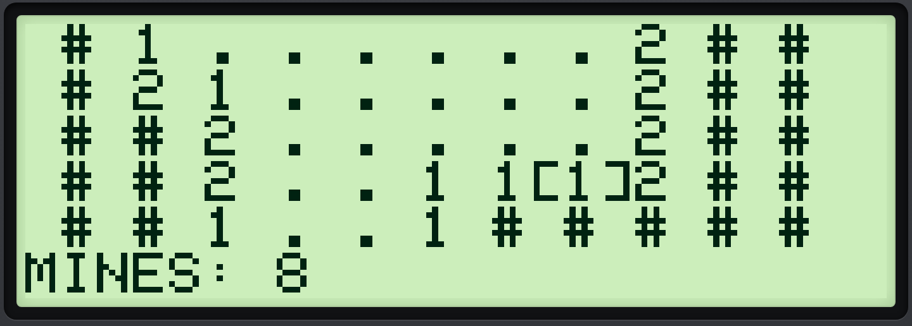

# minesweeper-emu

PC-G850 / PC-E200 系ポケコン向けの BASIC で書いたマインスイーパー (`minesweeper.bas`)。

[pc-e200-emu](https://github.com/mesaka/pc-e200-emu) の BASIC モードで動作確認しています。
**実機の BASIC では未検証です** (`INKEY$` の矢印キーのコード 28〜31 などはエミュレータの仕様に依存)。

## 画面の見方
盤面は 11 列 x 5 行、地雷は 8 個です。1 マスは 1 文字で、下の行は状態表示です。

| 表示 | 意味 |
|---|---|
| `#` | まだ開いていないマス |
| `.` | 開いたマスで、周囲 8 マスに地雷がない (0 マス) |
| `1`〜`8` | 開いたマスで、周囲 8 マスにある地雷の数 |
| `F` | 旗 (地雷だと思うマスの目印) |
| `*` | 地雷 (ゲームオーバー時に全部表示) |
| `[ ]` | カーソル。`[` と `]` で囲まれたマスが操作対象 |
| `MINES: n` | 残りの地雷数 (地雷の数 8 から、立てた旗の数を引いた値) |
| `BOOM! ANY KEY:RETRY` | 地雷を開いた (ゲームオーバー) |
| `CLEARED! ANY KEY` | 地雷以外のすべてのマスを開いた (クリア) |

## キー操作
| 操作 | キー |
|---|---|
| カーソル移動 (端で反対側へ回り込む) | 矢印キー / `W` `A` `S` `D` |
| マスを開く | `Space` / `Z` |
| 旗を立てる・外す (開いたマスには立てられない) | `F` / `X` |
| 最初からやり直す | `R` |
| 開始 / ゲームオーバー・クリア後に再開 | 任意のキー |

## ルール
- 数字は、そのマスの周囲 8 マスにある地雷の数です。数字を手がかりに地雷の場所を推理します。
- 地雷以外のマスをすべて開けばクリアです。地雷を開くと負けです。
- 初手は必ず安全です (最初に開いたマスとその周囲には地雷を置きません)。
- 周囲に地雷がないマス (`.`) を開くと、隣のマスが連鎖して開きます。

## 遊び方
1. pc-e200-emu を開き、モードを BASIC にする。
2. プログラム欄に `minesweeper.bas` の内容を貼り付ける (またはファイルを読み込む)。
3. 「RUN」を押す。動作が遅いときは速度設定を上げる。
4. 画面が出たら、何かキーを押して開始する。

## ライセンス
[MIT License](LICENSE)
